

---



---

**作者**：[TonTon Huang Ph.D.](https://www.twman.org/)  
**Blog**：[2026年11月10日，在 CodeSpace 安裝 Hermes (個人部落格原文)](https://blog.twman.org/2026/11/CodeSpace-Hermes.html)

> 📌 **技術速覽**
> **沒有自己的機器，也能在瀏覽器裡把 AI Agent 跑起來嗎？**
> 本篇記錄在 GitHub Codespace 用官方安裝腳本裝好 Nous Research 的 Hermes Agent (截圖時版本 v0.22.5)，跑完設定精靈、接上 LINE 官方帳號當對話介面，模型改走 NVIDIA NIM 的 Nemotron，全程在瀏覽器裡完成，不用準備自己的機器。文末再附上由這次安裝長出的延伸研究草案：MCP 工具輸出完整性與間接提示詞防禦。

---

# 《在 CodeSpace 安裝 Hermes：瀏覽器裡裝好 AI Agent，再接上 LINE》
_官方安裝腳本 + 設定精靈 + Cloudflare Tunnel 打通 LINE Webhook，模型走 NVIDIA NIM 的 Nemotron_

## 建立 Codespace

打開官方 GitHub 專案：[NousResearch/hermes-agent](https://github.com/NousResearch/hermes-agent)

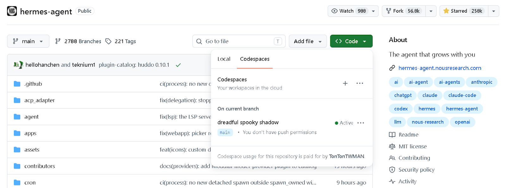

在 repo 頁點右上角 Code，選 Codespaces 分頁建立新的 Codespace (圖中是已經建好的那台)。注意下方那行提示：這個 repo 的 Codespace 用量算在自己帳號，免費額度用完會開始計費。

Codespace 開啟後的第一個畫面是 VS Code 的信任詢問，因為接下來要在終端機執行安裝指令，選「信任資料並繼續」。

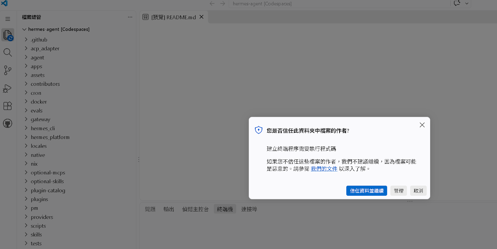

環境就緒：左邊是 hermes-agent 原始碼，下方終端機停在 /workspaces/hermes-agent，接著就可以安裝。

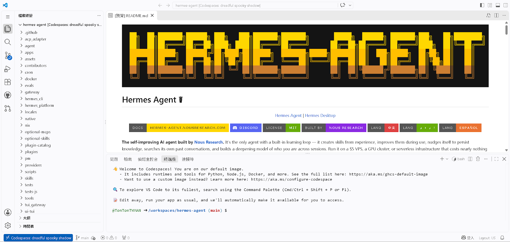

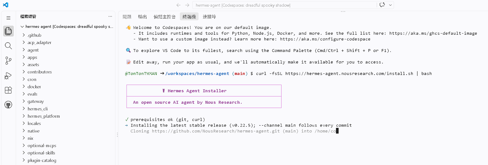

## 安裝 Hermes

跑起來後會先檢查 git、curl 等前置工具，再下載最新穩定版 (截圖時是 v0.22.5) 開始安裝。

```bash
curl -fsSL https://hermes-agent.nousresearch.com/install.sh | bash
```

安裝完成的畫面：相依套件裝好、設定檔建在 /home/codespace/.hermes、hermes 指令已加入 PATH。接著自動進入設定精靈，第一步是 Nous Portal 登入 (在瀏覽器開連結、輸入裝置碼核准)。Nous Portal 是官方的訂閱制模型來源，一個訂閱含 300 多個模型與工具閘道；本文後段改用 NVIDIA NIM，不用 Nous Portal 也可以跑。

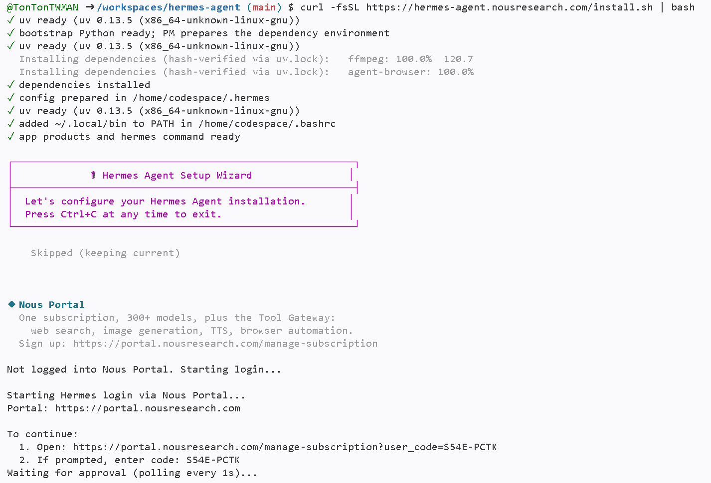

```bash
hermes setup
```

設定精靈問的第一件事是終端機後端 (terminal backend)：Agent 要在哪裡執行指令。在 Codespace 裡直接選 Keep current (local) 就好，其他是 Docker、Modal、SSH 遠端主機等進階選項。

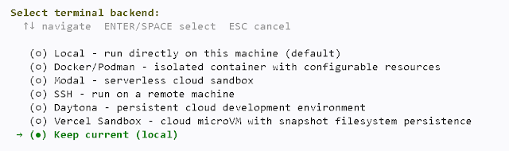

接著問要不要現在連接訊息平台，選 Set up messaging now (之後想補設定，下 hermes setup gateway 也可以)。

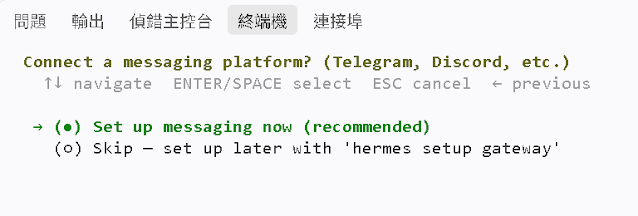

## 串接 LINE 官方帳號

平台清單有近 30 種 (Telegram、Discord、Slack、WhatsApp、WeChat 等)，這次勾 LINE。

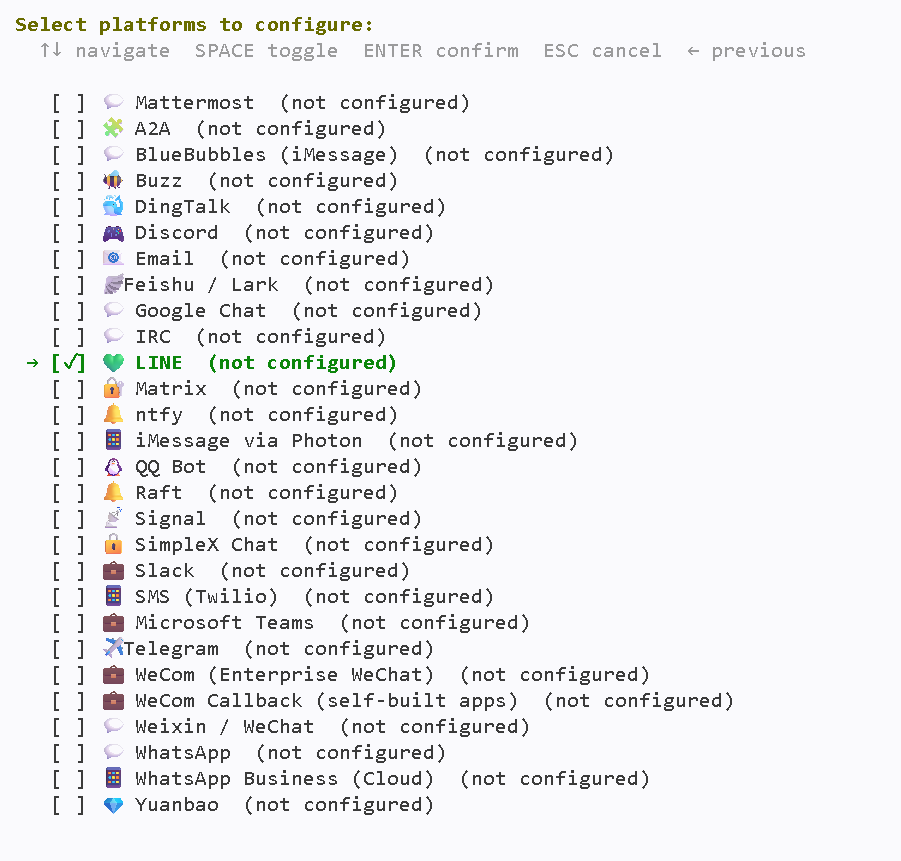

在 LINE Developers Console 進到這個頻道的 Messaging API 分頁，需要的第一把鑰匙是下方的 Channel access token (long-lived)，複製起來等一下要用 (截圖已馬賽克處理)。

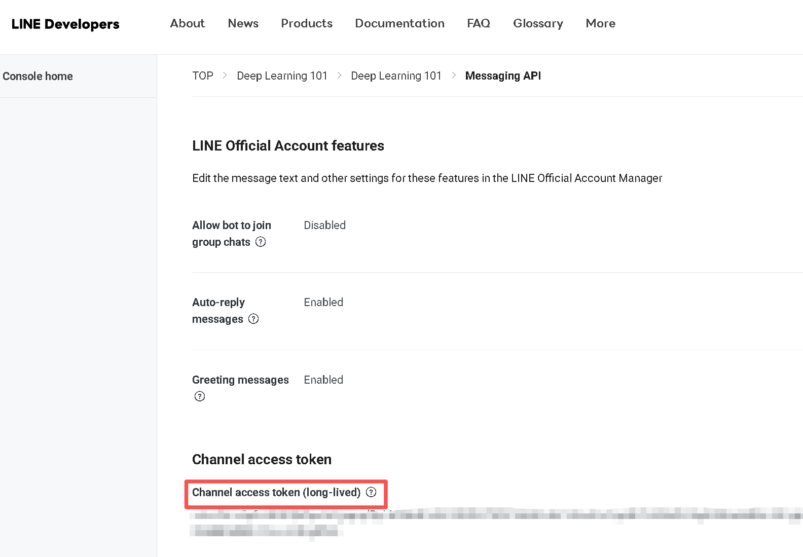

第二把鑰匙在 Basic settings 分頁的 Channel secret。這組 token 加 secret，等一下都要填進 Hermes 的設定裡。

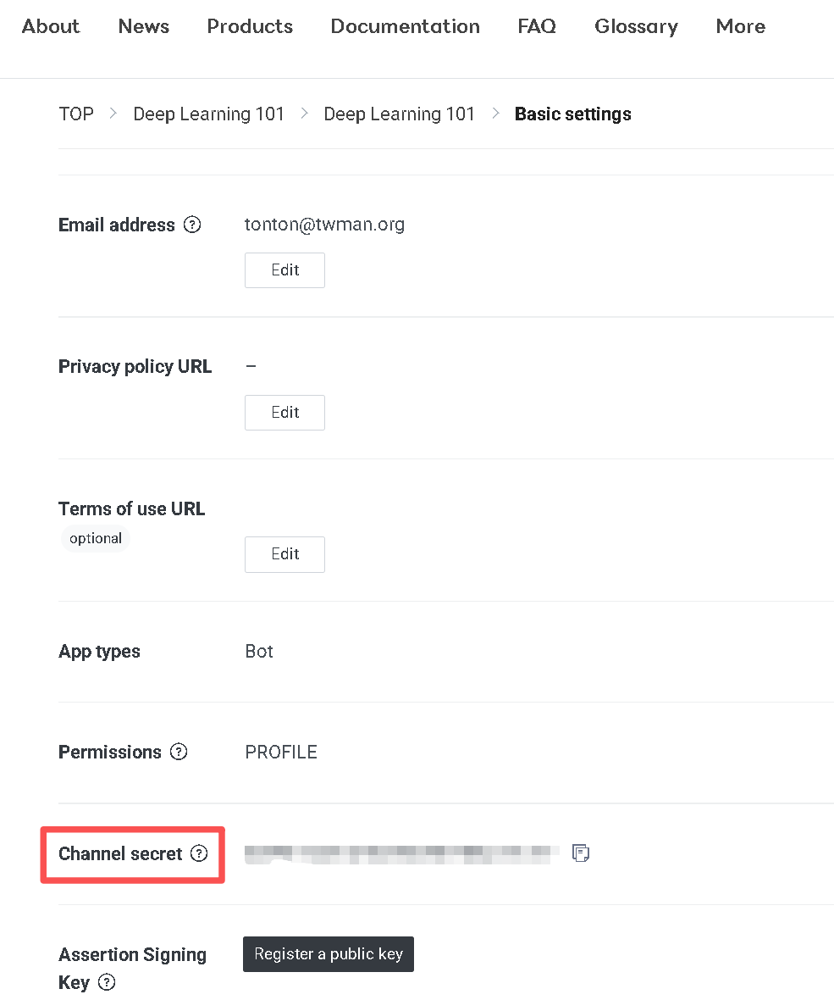

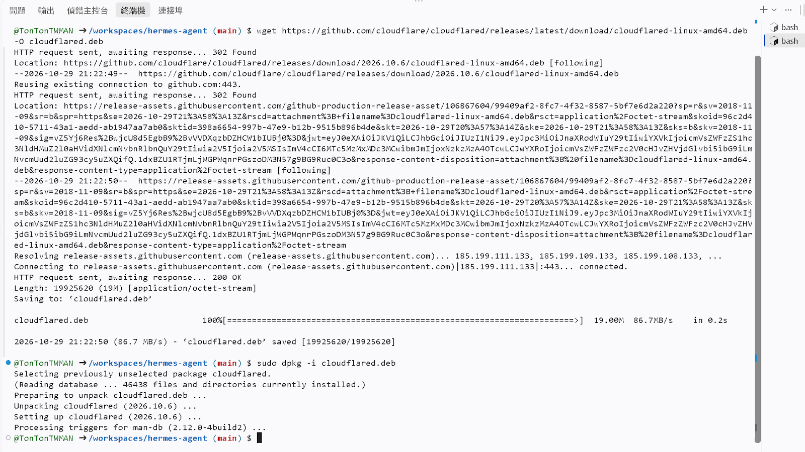

## 用 Cloudflare Tunnel 打通 Webhook

cloudflared 下載並以 dpkg 安裝完成 (版本 2026.10.6)。裝它的目的：Codespace 本身沒有公開網址，LINE 的 Webhook 需要一個外網連得到的 URL，要靠 Cloudflare Tunnel 打通。

```bash
wget https://github.com/cloudflare/cloudflared/releases/latest/download/cloudflared-linux-amd64.deb -O cloudflared.deb
sudo dpkg -i cloudflared.deb
cloudflared tunnel --url http://localhost:8646
```

執行 tunnel 後會拿到一個 trycloudflare.com 的臨時網址 (紅框處)，這就是等一下要填進 LINE 後台的 Webhook 來源。注意：這種免帳號的快速隧道每次重啟網址都會變，Codespace 或 tunnel 重開後，LINE 後台的 Webhook URL 要跟著換。

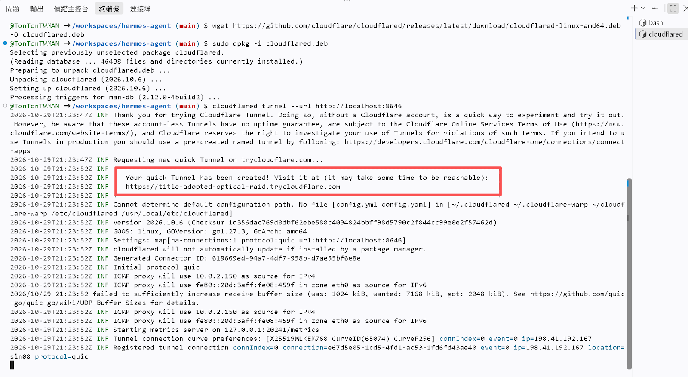

回 LINE Developers Console 的 Messaging API 分頁，把 Webhook URL 填成剛拿到的隧道網址加上 /line/webhook，並把 Use webhook 打開。

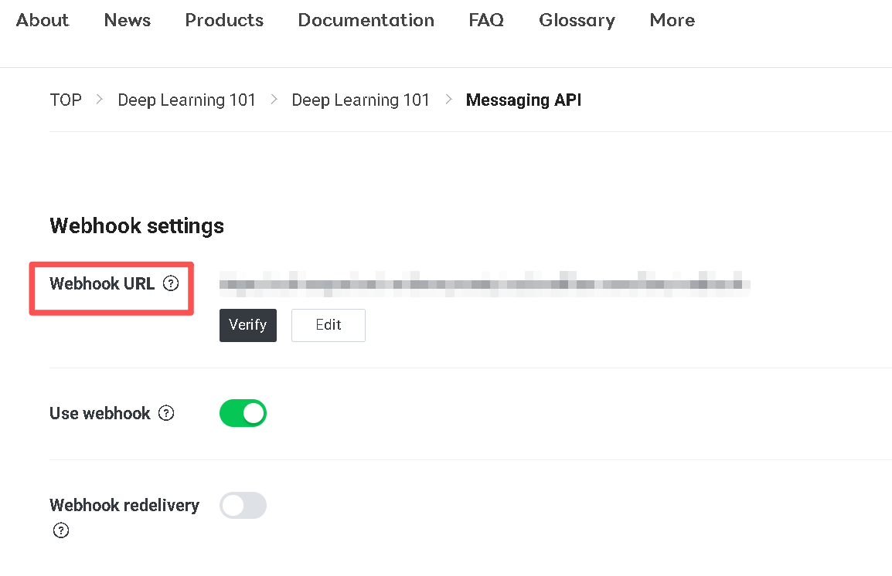

設定精靈還會問要不要把匿名使用統計回傳給 Nous (Help improve Hermes?)，這裡選 No thanks；之後想改，下 hermes setup telemetry 即可。

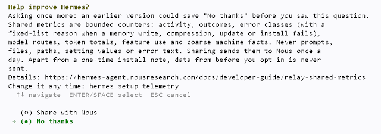

Setup Complete：所有設定集中在 ~/.hermes (config.yaml 管設定、.env 管金鑰)。畫面也列了日後調整用的指令，例如 hermes setup gateway 重設訊息平台、hermes doctor 做健康檢查。

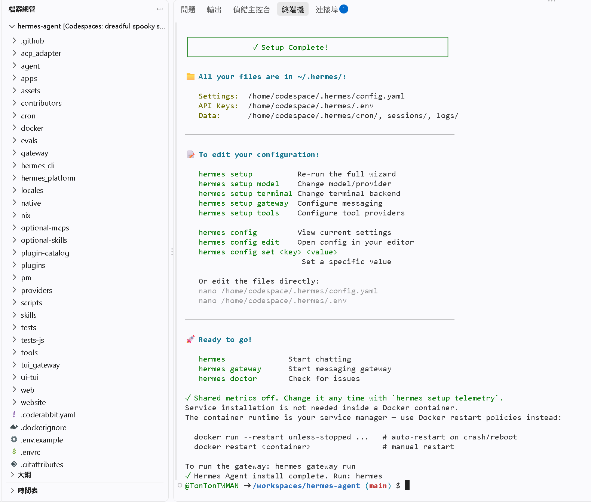

下 hermes gateway 啟動訊息閘道。上方兩串警告要看：一是還沒設使用者白名單，未設定時閘道預設拒絕陌生人傳訊；二是 Nous Portal 未登入的提示，因為模型改走 NVIDIA NIM，這個可以忽略。下一步就把 LINE 的三個值寫進 .env 補上白名單。

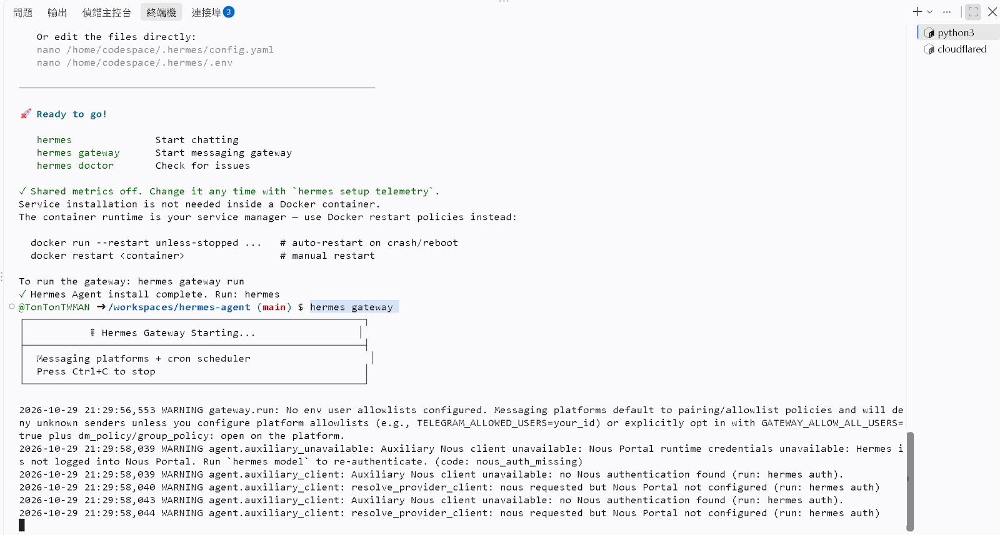

```bash
LINE_CHANNEL_ACCESS_TOKEN=<redacted>
LINE_CHANNEL_SECRET=<redacted>
LINE_ALLOWED_USERS=你的LINE使用者ID (U 開頭，逗號分隔)
```

.env 寫好、gateway 重新啟動後，回 LINE 後台按 Webhook 的 Verify，跳出 Success 就代表 LINE 已經能把訊息送進 Codespace 裡的 Hermes。

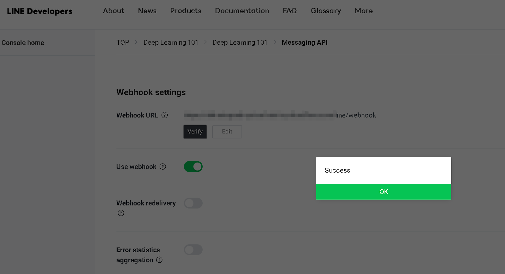

## 模型改走 NVIDIA NIM

再下 hermes 進入對話介面 (v0.22.5，內建 20 個工具、54 個技能)。第一次進來會提示還沒設定推論供應商，跟著往下設定。

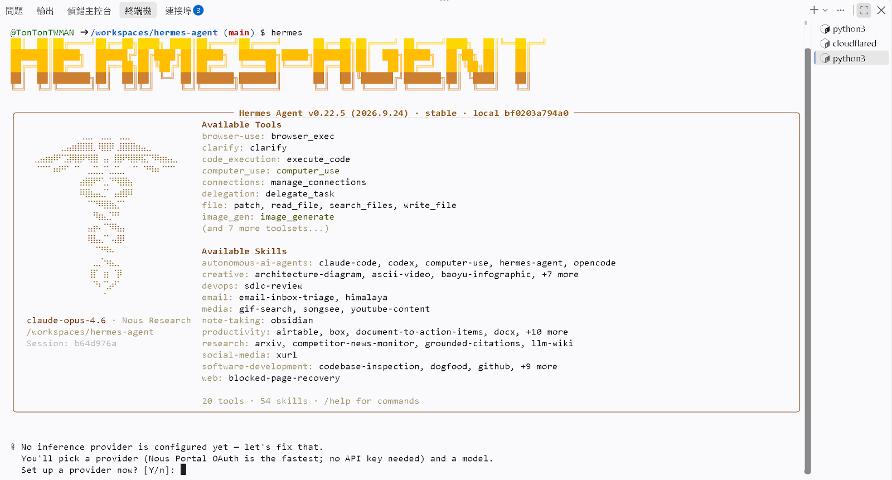

供應商清單很長 (Nous Portal、Anthropic、OpenAI、OpenRouter 等)，這次選 NVIDIA NIM：用 build.nvidia.com 的 API 跑 Nemotron 等模型。

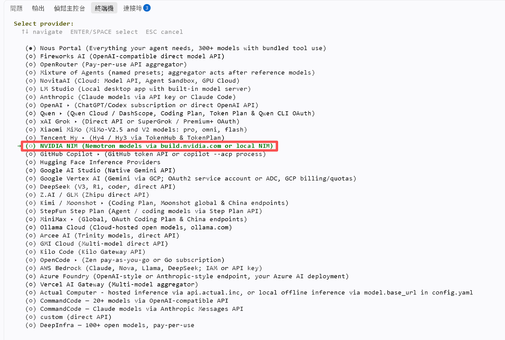

貼上 NVIDIA_API_KEY 後會存檔，接著確認 Base URL，預設的 https://integrate.api.nvidia.com/v1 直接用就好。

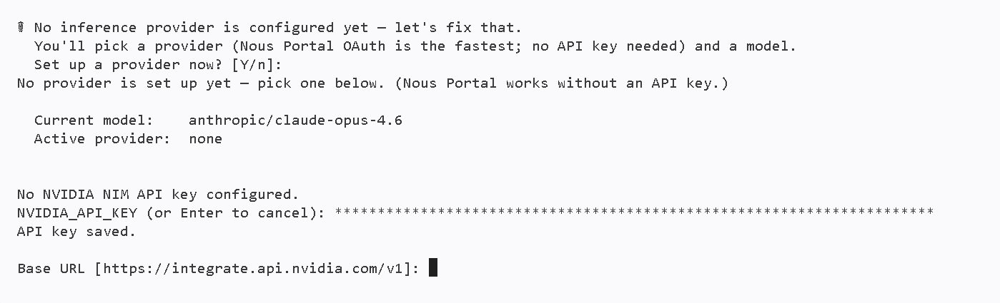

選預設模型：清單是 NIM 上可用的模型，這裡選 nvidia/nemotron-3.5-super-v1-120b-a12b。

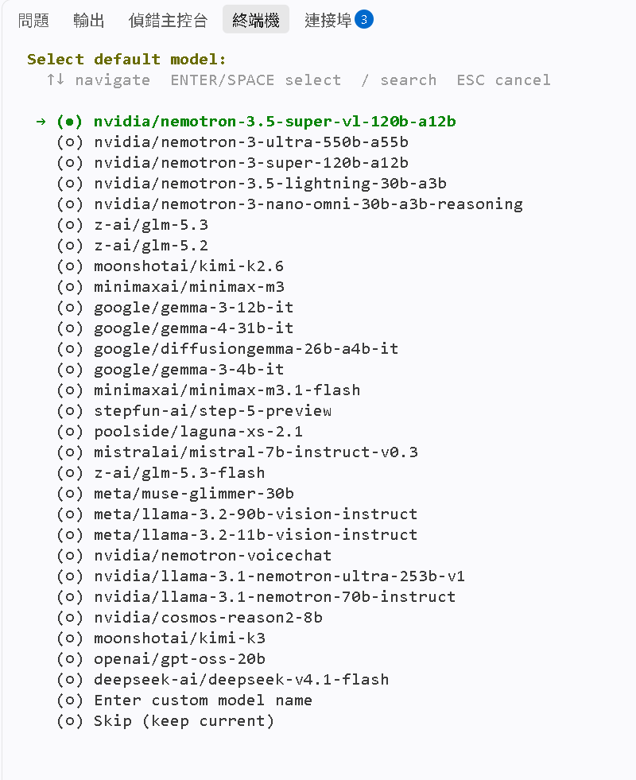

推理強度 (reasoning effort) 選 medium。

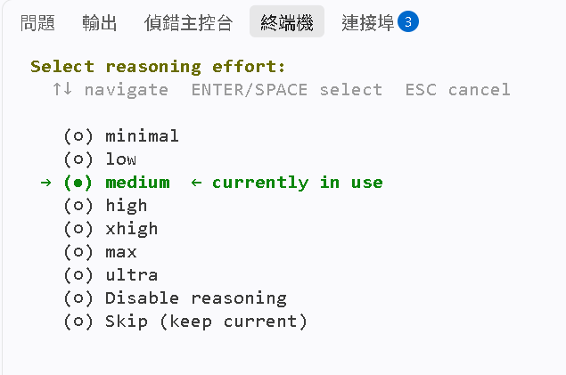

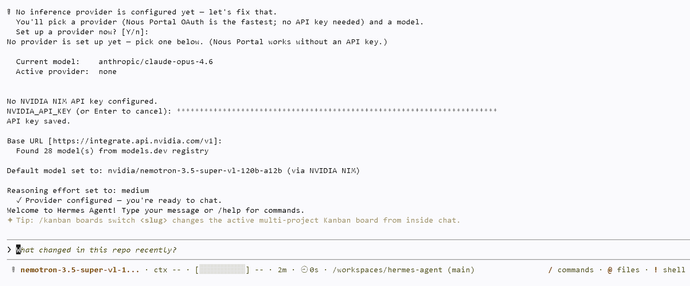

設定完成：畫面確認供應商設好、預設模型是 nemotron-3.5-super-v1-120b-a12b、推理強度 medium，可以開始對話了。

先在終端機介面問它能做什麼，Nemotron 用繁體中文條列回覆，能力包含寫程式與操作程式庫、瀏覽器自動化、委派子代理、排程、多媒體等。

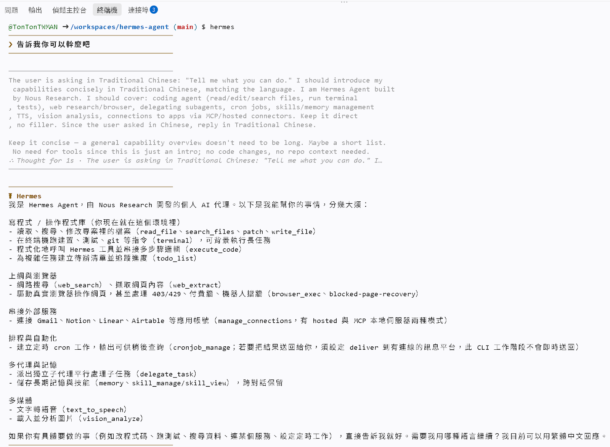

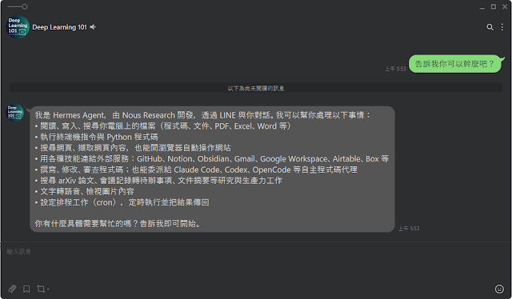

最後是 LINE 端實測：在 Deep Learning 101 官方帳號問同一句，Hermes 透過剛設好的 Webhook 與隧道正常回覆，整條鏈路打通。提醒一句：Codespace 閒置會自動關機，gateway 與 tunnel 都要重開，網址變了記得回 LINE 後台更新 Webhook URL。

---

## 延伸研究：裝完 Hermes 之後，我想用它做一篇 MCP 防禦研究

這次安裝不是裝好玩的。Hermes 是原生 MCP client，而我正在規劃的研究正好以它為實驗主體：工具輸出未經檢查就進模型上下文，是間接提示詞注入的主要入口。這次打通的 Codespace + Hermes + NVIDIA NIM 組合，就是研究第一個里程碑 (M1) 要驗證的環境。研究架構草案全文如下。

**題目：基於 Model Context Protocol 之 AI Agent 工具輸出完整性與間接提示詞防禦機制研究**

### 一、研究定位與缺口

AI Agent 透過 MCP 呼叫外部工具時，工具輸出未經任何內容檢查就直接進入模型上下文，這是間接提示詞注入(indirect prompt injection)的主要入口：攻擊者不需要接觸使用者，只要把指令埋進工具會回傳的資料(網頁、文件、查詢結果)，Agent 讀到就可能被劫持。

現有防線有兩個已確認的缺口。第一，Agent 本體不管輸出內容：以本研究採用的 Hermes Agent 為例，它是原生 MCP client，但對工具輸出沒有內容檢查機制，只有環境變數過濾與錯誤訊息中的金鑰遮罩。第二，傳統掃描不懂意圖：字串與關鍵字比對抓不到語意層的任務劫持(此為先前護欄研究 Q11 的結論)，需要判斷層，而非更長的黑名單。

MCP 代理本身已有開源先行者(MCPKernel 的汙點追蹤與雜湊簽章信封、Pipelock、Enkrypt MCP Gateway、LiteLLM 的 pre_mcp_call)，因此本研究的賣點不在「做一個代理」，而在四項尚未有人湊齊的整合：校準機率的語意判斷、完整性雜湊鏈、執行期邊界強制、繁體中文注入評測集。

### 二、系統架構與分工

攔截位置在設定檔層級，不改 Hermes 本體。Hermes 的 MCP 伺服器定義寫在 ~/.hermes/config.yaml 的 mcp_servers：stdio 傳輸時把 command 改指向本研究的攔截代理、由代理啟動真正的伺服器；HTTP 傳輸時把 url 改指向代理端點。Hermes 無感，但每一則 JSON-RPC 訊息都先過代理，包括 tools/list 的工具描述、tools/call 的參數與回應，以及容易被漏掉的伺服器反向 sampling 請求。

全案統一用詞為「訊息層攔截」，計畫書中應主動說明不用「封包攔截」的原因：stdio 傳輸沒有網路封包，HTTP 傳輸經 TLS 加密、封包層只見密文，能做語意判斷的位置只有 JSON-RPC 訊息層。

三個零件的分工如下：

| 零件 | 負責什麼 | 機制 | 性質 |
|---|---|---|---|
| 訊息層攔截與轉發模組 | 完整性 | 工具清單首次探索時將名稱、描述、inputSchema 做雜湊釘選，之後每次連線比對，變動即阻擋(防 rug pull)；呼叫參數與回應內容逐筆做雜湊鏈串連並做 schema 驗證，形成不可竄改的稽核紀錄 | 確定性檢查，不使用 AI |
| Decision 3.0(vLLM Semantic Router) | 語意判斷 | 每筆工具輸出在回到 Agent 前送審，以結構化問題判斷「是否含有針對 Agent 的指令、且與使用者原始任務不一致」，回傳校準機率，依門檻分三級處置：放行、遮罩、阻擋 | 高頻逐筆決策，成本與延遲遠低於完整 LLM 裁判 |
| NVIDIA NIM 的 LLM | 複核與對照 | 對低信心區間的判斷做第二意見複核；同時作為評測中的「完整 LLM 裁判」對照組 | 主備援模式，與 Factiva 管線的既有作法一致 |
| NVIDIA OpenShell | 邊界強制 | 依其架構說明，Hermes、代理與 MCP 伺服器全部跑在其 sandbox 內；網路預設拒絕、僅放行核准路徑(如代理連向 Decision 3.0 與 NIM)；supervisor 可檢視 MCP 流量(同一 API 可設准讀擋寫)；稽核輸出 OCSF 格式 | 內容判斷被騙過時的最後防線，限制爆炸半徑 |

資料流：使用者 → Hermes → 攔截代理(完整性檢查)→ MCP 伺服器 → 工具回應 → 攔截代理(雜湊鏈紀錄、Decision 3.0 判斷、三級處置)→ Hermes → 模型。反向 sampling 請求比照辦理，同樣過代理。

### 三、里程碑(週數為草案建議，可依計畫期程調整)

| 里程碑 | 內容 | 驗收條件 |
|---|---|---|
| M1(第 1 至 2 週)OpenShell 可行性驗證 | 最高風險先行：在 Codespace 內跑起 OpenShell，讓 Hermes 在 sandbox 內完成一次完整的 MCP 工具呼叫 | 判定成功或失敗並留下資源用量紀錄(Codespace 規格下的 CPU、記憶體、磁碟)；失敗即切換備案(本機或獨立 VM 部署)，架構其餘部分不變 |
| M2(第 3 至 4 週)攔截代理 MVP | stdio 與 HTTP 兩種傳輸的透明轉發，JSON-RPC 訊息全量紀錄，含反向 sampling | Hermes 功能無感(既有工具呼叫行為不變)；訊息零遺漏(與無代理直連的計數對照一致) |
| M3(第 5 至 6 週)完整性模組 | 工具清單雜湊釘選、逐筆雜湊鏈、schema 驗證、稽核紀錄查詢 | 模擬 rug pull(連線中途竄改工具描述)必被阻擋；事後竄改任一筆稽核紀錄必被驗出 |
| M4(第 7 至 9 週)語意判斷整合 | 串接 Decision 3.0、三級處置與門檻掃描、NIM 複核路徑；先以小規模繁中樣本校準判斷品質 | 端到端延遲量測完成(每筆工具輸出增加的延遲有數字)；門檻與處置行為可重現 |
| M5(第 10 至 13 週)評測集與實驗 | 建立繁中注入語料並跑完評測設計的全部對照組與消融實驗 | 產出第五節所列全部指標與對照表 |
| M6(第 14 至 16 週)分析與撰寫 | 結果分析、與先行者比較、計畫書與成果文件撰寫 | 交付研究報告與開源實作 |

### 四、評測設計

語料：建立繁體中文間接注入評測集。依工具輸出型態分場景(網頁內容、文件摘要、資料庫查詢結果、API 回應、程式碼與註解)，依注入手法分類(直接命令、角色偽裝、任務劫持、資料滲出誘導、延遲觸發)；雙人標註並報告標註一致性；另備英文對照子集，與公開注入 benchmark(如 AgentDojo 類)的手法分類對齊，確保結果可與國際研究對話。

指標：攻擊成功率(ASR，防禦前後對照)、誤擋率(正常工具輸出被遮罩或阻擋的比例，即可用性代價)、偵測率與 ROC 曲線(門檻掃描)、每筆判斷的延遲與成本(Decision 3.0 對比 NIM 裁判)、完整性檢出率(rug pull 與紀錄竄改情境)。

對照組：(a)無防禦的 Hermes 原生配置；(b)純字串與關鍵字掃描；(c)完整 LLM 裁判(NIM)；(d)本研究完整架構；(e)消融組：分別拿掉雜湊鏈與拿掉邊界層，量測各層的獨立貢獻。

實驗控制：主實驗固定 Hermes 版本與模型供應商(NVIDIA NIM Nemotron，版本寫入實驗紀錄)，避免模型漂移污染結果；注入語料與真實工具鏈的生態效度在報告中專節討論。

### 五、風險與備案

| 風險 | 影響 | 備案 |
|---|---|---|
| OpenShell 尚在 0.1 alpha 且為 K3s 加 Docker 的重量級架構，在 Codespace 內可能跑不順或資源不足 | 全案最大的工程風險 | M1 最先驗證；不行就改部署於本機或獨立 VM，三層架構與研究問題不變 |
| Decision 3.0 對繁體中文語料的判斷品質未驗證 | 語意層成效不確定 | M4 先以小規模繁中樣本校準；品質不足時以 NIM 複核比例拉高因應，並如實報告 |
| 逐筆送審的延遲與成本 | 即時互動體驗 | 以輸出雜湊做快取(相同輸出跳過重判)、依工具風險分級決定全檢或抽檢，列為設計參數並量測 |
| Codespace 閒置自動停止 | 不適合長時間連續實驗 | 批次實驗改在可持續運行的環境執行，Codespace 定位為開發與展示環境 |

### 六、預期貢獻

一，首個將校準機率語意判斷、完整性雜湊鏈與執行期邊界強制三層整合於 MCP 訊息層的開源實作，且不需修改 Agent 本體即可套用到任何標準 MCP client。二，釋出繁體中文間接提示詞注入評測集與標註方法，補上目前以英文為主的評測版圖。三，以消融實驗量化每一層防禦的獨立貢獻與代價(延遲、誤擋)，供後續研究與實務部署選型參考。
